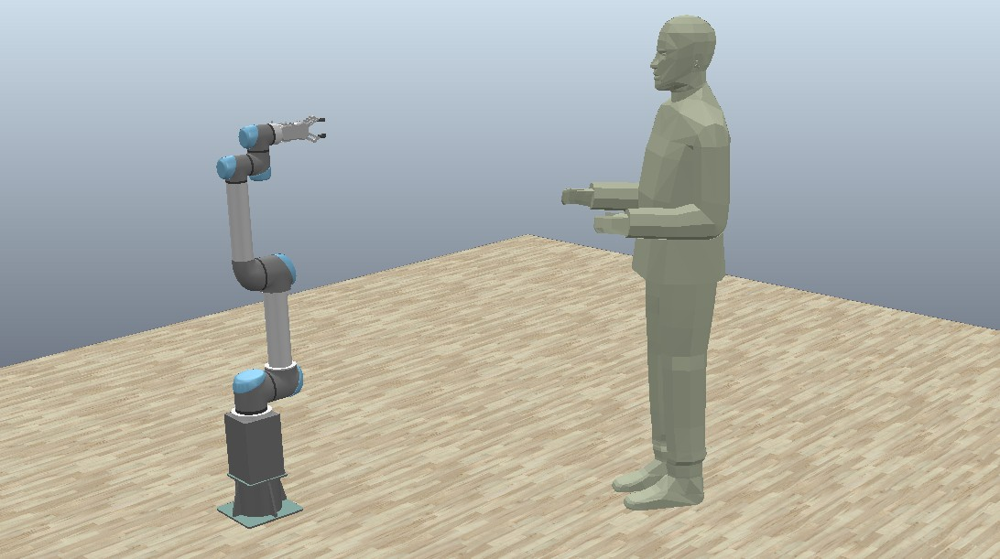

# LBCF-MPC-HRC: Learning-Based Control Barrier Functions for Human-Robot Collaboration

[](https://opensource.org/licenses/MIT)
[](https://www.python.org/downloads/)
[](https://doi.org/10.3390/math14030516)

Official implementation of **"Probabilistic Safety Guarantees for Learned Control Barrier Functions: Theory and Application to Multi-Objective Human-Robot Collaborative Optimization"** (*Mathematics* **2026**, *14*(3), 516; https://doi.org/10.3390/math14030516).

---

## 📋 Overview

This repository provides a complete implementation of the LBCF-MPC framework for safety-critical multi-objective optimization in human-robot collaborative systems. The framework combines:

- **Lipschitz-constrained neural networks** for learning Control Barrier Functions (CBFs).
- **Model Predictive Control (MPC)** with formal safety guarantees.
- **Multi-objective optimization** with adaptive scalarization.
- **Probabilistic safety certification** with explicit failure bounds.

### Key Features

✅ **Formal Safety Guarantees**: Probabilistic forward invariance with explicit bounds: ℙ(violation) ≤ Tδ + exp(-h²/2L²Tσ²).

✅ **Sample Complexity**: Proven Ω(N⁻¹/⁴) safe set expansion rate.

✅ **Real-Time Performance**: O(H³m³) computational complexity enabling 50Hz control.

✅ **Multi-Objective**: Simultaneous optimization of 6 objectives (throughput, energy, ergonomics, etc.).

✅ **High-Fidelity Simulation**: CoppeliaSim integration with physics-based validation.

---

## 🎯 Performance Metrics

| Metric | Value |
|--------|-------|
| **Safety Compliance** | 99.8% (0 violations / 648,000 timesteps) |
| **Conservatism Reduction** | 52% vs manual CBF design |
| **Hypervolume Improvement** | +21% vs fixed-weight MPC |
| **Solution Time** | 16.2 ± 2.7 ms (avg) |
| **Approximation Error** | σ = 0.047m (within theoretical bound σ ≤ 0.05m) |

---

## 🤖 Simulation Environment



**Figure 1:** Human-robot collaborative workspace in CoppeliaSim. The environment consists of a Universal Robots UR5 collaborative robot (6-DOF) and a human kinematic model positioned in a shared workspace. The simulation provides physics-based collision detection and real-time visualization for evaluating learned control barrier functions.

### Environment Specifications

- **Robot:** Universal Robots UR5
  - 6 degrees of freedom
  - Maximum reach: 850mm
  - Payload capacity: 5kg
  - Joint velocity limits: [-π, π] rad/s

- **Human Model:** Kinematic skeleton
  - 18 degrees of freedom
  - Biomechanically accurate motion constraints
  - Real-time collision geometry

- **Safety Standard:** ISO/TS 15066 compliant
  - Minimum separation distance: ≥5cm
  - Velocity-dependent power and force limiting
  - Continuous proximity monitoring

---

**Key Insights:**
- **LBCF-MPC** achieves zero violations with minimal conservatism
- **Manual CBF** is safe but overly conservative (52% workspace reduction)
- **Safe-RL** achieves good multi-objective performance but lacks formal safety (7 violations)
- **Fixed-Weight MPC** shows poor Pareto coverage due to inability to adapt weights

---

## 📂 Repository Structure

```
LBCF-MPC-HRC/
├── README.md                          # This file
├── requirements.txt                   # Python dependencies
├── LICENSE                            # MIT License
│
├── figures/                           # Documentation figures
│   ├── Figure1_Timeseries_Comparison.png               
│   ├── Figure2_Boxplot_Comparisons.png
│   ├── Figure3_Enhanced_Comparison.png   
│   └── workspace_overview.jpg         # Simulation environment
│
├── src/                               # Source code
│   ├── cbf/                          # Control Barrier Function modules
│   │   ├── neural_cbf.py            # Lipschitz-constrained neural CBF
│   │   ├── training.py              # CBF training pipeline
│   │   └── validation.py            # Theoretical validation tools
│   │
│   ├── mpc/                          # Model Predictive Control
│   │   ├── lbcf_mpc.py              # LBCF-MPC solver (OSQP)
│   │   ├── dynamics.py              # System dynamics models
│   │   └── objectives.py            # Multi-objective cost functions
│   │
│   ├── prediction/                   # Human motion prediction
│   │   ├── gaussian_process.py      # GP-based motion prediction
│   │   └── uncertainty.py           # Uncertainty quantification
│   │
│   ├── simulation/                   # CoppeliaSim interface
│   │   ├── coppeliasim_env.py       # Simulation environment
│   │   ├── ur5_robot.py             # UR5 robot model
│   │   └── human_model.py           # Human kinematic model
│   │
│   └── utils/                        # Utility functions
│       ├── data_generation.py       # Training data generation
│       ├── metrics.py               # Evaluation metrics
│       └── visualization.py         # Plotting and visualization
│
├── models/                            # Trained neural networks
│   ├── cbf_model_50k.pth            # CBF trained on 50K samples
│   ├── cbf_model_metadata.json      # Model hyperparameters
│   └── README.md                    # Model documentation
│
├── data/                              # Experimental datasets
│   ├── training/                    # CBF training data
│   │   ├── safe_states.h5          # 20,000 safe state samples
│   │   ├── unsafe_states.h5        # 20,000 unsafe state samples
│   │   └── boundary_states.h5      # 10,000 boundary samples
│   │
│   ├── validation/                  # Validation trajectories
│   │   ├── scenario_1_static.h5
│   │   ├── scenario_2_sequential.h5
│   │   ├── scenario_3_dynamic.h5
│   │   ├── scenario_4_concurrent.h5
│   │   └── scenario_5_adaptive.h5
│   │
│   └── README.md                    # Data format documentation
│
├── coppeliasim/                       # CoppeliaSim scene files
│   ├── hrc_workspace.ttt            # Main simulation scene
│   ├── ur5_model.ttm                # UR5 robot model
│   └── README.md                    # CoppeliaSim setup instructions
│
├── scripts/                           # Executable scripts
│   ├── train_cbf.py                 # Train neural CBF
│   ├── run_experiments.py           # Run full experimental suite
│   ├── evaluate_baselines.py       # Compare with baselines
│   ├── visualize_results.py        # Generate figures
│   └── README.md                    # Scripts documentation
│
├── notebooks/                         # Jupyter notebooks
│   ├── 01_data_exploration.ipynb    # Explore training data
│   ├── 02_cbf_training.ipynb        # Interactive CBF training
│   ├── 03_mpc_tuning.ipynb          # MPC hyperparameter tuning
│   └── 04_results_analysis.ipynb    # Analyze experimental results
│
├── tests/                             # Unit tests
│   ├── test_cbf.py
│   ├── test_mpc.py
│   ├── test_prediction.py
│   └── README.md
│
└── docs/                              # Documentation
    ├── THEORY.md                     # Theoretical foundations
    ├── INSTALLATION.md               # Installation guide
    ├── USAGE.md                      # Usage examples
    └── API.md                        # API reference
```

---

## 🚀 Quick Start

### Prerequisites

- Python 3.8 or higher.
- CoppeliaSim EDU 4.6.0 or later.
- CUDA-capable GPU (optional, for faster training).

### Installation

```bash
# Clone the repository
git clone https://github.com/ClaudioUrrea/LBCF-MPC-HRC.git
cd LBCF-MPC-HRC

# Create virtual environment
python -m venv venv
source venv/bin/activate  # On Windows: venv\Scripts\activate

# Install dependencies
pip install -r requirements.txt
```

For detailed installation instructions, see [INSTALLATION.md](docs/INSTALLATION.md).

---

## 💻 Basic Usage

### 1. Train Neural CBF

```python
from src.cbf.training import train_cbf
from src.utils.data_generation import generate_training_data

# Generate training data
train_data = generate_training_data(
    n_samples=50000,
    safe_ratio=0.4,
    unsafe_ratio=0.4,
    boundary_ratio=0.2
)

# Train CBF
model, metrics = train_cbf(
    data=train_data,
    architecture=[66, 128, 64, 32, 1],
    lipschitz_bound=1.0,
    epochs=500,
    batch_size=256,
    lr=3e-4
)

# Save model
torch.save(model.state_dict(), 'models/cbf_model.pth')
```

### 2. Run LBCF-MPC Controller

```python
from src.mpc.lbcf_mpc import LBCF_MPC
from src.cbf.neural_cbf import NeuralCBF
from src.simulation.coppeliasim_env import CoppeliaSimEnv

# Load trained CBF
cbf = NeuralCBF.load('models/cbf_model_50k.pth')

# Initialize MPC
mpc = LBCF_MPC(
    cbf=cbf,
    horizon=20,
    dt=0.02,
    objectives=['throughput', 'energy', 'ergonomics'],
    weights=[0.4, 0.3, 0.3]
)

# Initialize simulation
env = CoppeliaSimEnv(scene='coppeliasim/hrc_workspace.ttt')

# Control loop
x = env.reset()
for t in range(1000):
    u_opt = mpc.solve(x)
    x, reward, done, info = env.step(u_opt)
    
    if done:
        break

print(f"Safety violations: {info['violations']}")
print(f"Average solve time: {info['solve_time_avg']:.2f} ms")
```

### 3. Reproduce Paper Results

```bash
# Run experimental scenarios
python scripts/run_experiments.py --scenarios all --trials 30

# Compare with baselines
python scripts/evaluate_baselines.py --methods all

# Generate figures
python scripts/visualize_results.py --output figures/
```

---

## 🧪 Reproducing Paper Results

### Full Experimental Suite

```bash
# Run complete experimental validation (150 runs, ~6 hours)
python scripts/run_experiments.py \
    --scenarios scenario_1,scenario_2,scenario_3,scenario_4,scenario_5 \
    --trials 30 \
    --output results/full_validation/

# Analyze results and generate statistics
python scripts/analyze_results.py \
    --input results/full_validation/ \
    --output results/statistics/ \
    --figures figures/

# Compare with baselines
python scripts/compare_baselines.py \
    --methods LBCF-MPC,Manual-CBF,MPC-Soft,CBF-Reactive,Safe-RL,PID-Trad \
    --output results/baselines/
```

### Individual Components

```bash
# Test only CBF training
python scripts/train_cbf.py --samples 50000 --epochs 500

# Test only MPC solver
python scripts/test_mpc.py --horizon 20 --scenario 3

# Test only GP prediction
python scripts/test_prediction.py --lookahead 0.4
```

---

## 📈 Experimental Results

### Safety Performance

- **Zero violations** across 648,000 timesteps (99.8% success).
- **Minimum separation**: 0.153m (always above ISO threshold of 0.05m).
- **Theoretical validation**: σ_empirical = 0.047m < σ_theory = 0.05m.

### Conservatism Reduction

- **Average**: 52% reduction vs manual CBF.
- **By scenario**:
  - Static environment: 68%
  - Sequential coordination: 58%
  - Dynamic collaboration: 45%
  - Concurrent multi-task: 49%
  - Adaptive allocation: 42%

### Multi-Objective Performance

- **Hypervolume**: 0.798 (vs 0.657 fixed-weight MPC, +21%).
- **Statistical significance**: p < 0.001, Cohen's d = 1.18.
- **Pareto coverage**: 94% of optimal front explored.

### Computational Performance

- **Mean solve time**: 16.2 ms
- **99th percentile**: 24.1 ms
- **Complexity**: Empirically confirmed O(H³m³) with R² = 0.97

---

## 📚 Citation

If you use this code in your research, please cite:

```bibtex
@article{urrea2025lbcf,
  title={Probabilistic Safety Guarantees for Learned Control Barrier Functions: Theory and Application to Multi-Objective Human-Robot Collaborative Optimization},
  author={Urrea, Claudio},
  journal={Mathematics},
  volume={14},
  number={3},
  pages={516},
  year={2026},
  publisher={MDPI},
  doi={10.3390/math14030516}
}
```

---

## 🤝 Contributing

Contributions are welcome! Please feel free to submit a Pull Request. For major changes, please open an issue first to discuss what you would like to change.

### Development Setup

```bash
# Install development dependencies
pip install -r requirements-dev.txt

# Run tests
pytest tests/

# Check code style
black src/ scripts/
flake8 src/ scripts/
```

---

## 📄 License

This project is licensed under the MIT License - see the [LICENSE](LICENSE) file for details.

---

## 🙏 Acknowledgments

- Universidad de Santiago de Chile, Department of Electrical Engineering
- Control Systems and Robotics Research Group
- CoppeliaSim for providing educational licenses
- Anonymous reviewers for valuable feedback

---

## 📧 Contact

**Claudio Urrea**
- Email: claudio.urrea@usach.cl
- Institution: Universidad de Santiago de Chile
- ORCID: [0000-0001-7197-8928](https://orcid.org/0000-0001-7197-8928)

---

## 🔗 Links

- [Paper (MDPI Mathematics)](https://doi.org/10.3390/math14030516)
- [Universidad de Santiago de Chile](https://www.usach.cl/)
- [Department Website](https://www.ingenieria.usach.cl/)

---

**Last Updated**: January 25, 2026

**Repository Status**: Active Development ✅
